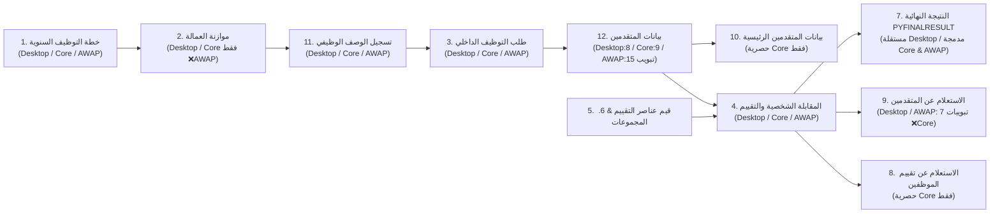
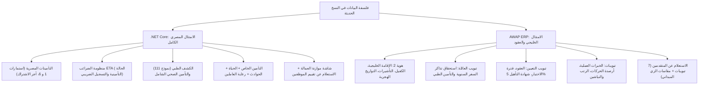
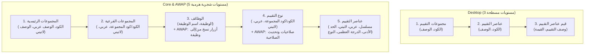

# المرجع الفني الشامل للمقارنة التفصيلية بين نسخ نظام الموارد البشرية والتوظيف
## (Desktop vs .NET Core vs AWAP ERP) — تحليل حقل بحقل وجريد بجريد بدون اختصار

> [!IMPORTANT]
> هذا المستند يمثل الدليل التحليلي الكامل لكافة الشاشات الـ **12** (إجمالي **96 لقطة شاشة**) عبر إصدارات النظام الثلاثة، متضمناً جرداً تفصيلياً لكل حقل، قائمة، سويتش، تبويب، جريد، عمود، زر إجراء، ومصفوفة دقيقة للنواقص والزيادات مدعومة بالرسوم التوضيحية والصور المقارنة.

---

## القسم الأول: الرؤية المعمارية والرسوم التوضيحية الشاملة

### 1.1 خريطة تدفق دورة التوظيف وموقع كل شاشة عبر النسخ الثلاث



### 1.2 الفروقات الجوهرية في التوجه التشريعي والجغرافي (Core vs AWAP)



### 1.3 مقارنة أشرطة الأدوات وأزرار النظام القياسية (System Toolbars)

| الوظيفة / الزر | Desktop (Oracle/WinForms) | .NET Core (الشريط السفلي والعلوي) | AWAP Web (الشريط العلوي) |
|---|---|---|---|
| **حفظ السجل** | أيقونة الديسك بالأسفل | زر أخضر بارز `حفظ` بالأسفل | أيقونة الديسك الزرقاء بالأعلى |
| **سجل جديد** | أيقونة صفحة بيضاء `+` | زر برتقالي `جديد +` بالأسفل | أيقونة الصفحة البيضاء بالأعلى |
| **حذف سجل** | أيقونة `X` حمراء | زر أحمر `حذف X` بالأسفل | أيقونة سلة المهملات بالأعلى |
| **المرفقات** | ❌ غير متاح موحداً | زر برتقالي `المرفقات` + زر `رفع متعدد للصور والمرفقات` | أيقونة دبوس الورق بالأعلى |
| **النماذج والقوالب** | ❌ غير متاح | زر أزرق `نموذج` بالأسفل | ❌ غير متاح كزر موحد |
| **الطباعة والتقارير** | قائمة منسدلة + زر `طباعة` | قائمة `التقرير - ابحث -` + زر تصميم + زر `طباعة` برتقالي | داخل الجريد أو شاشة التقارير |
| **التصدير (Export)** | زر `تصدير` محدود | 4 أزرار مستقلة بالأسفل: `PDF`, `Excel`, `Word`, `Image` | 8 أيقونات أعلى كل جريد: `XLSX`, `XLS`, `DOCX`, `RTF`, `PDF`, `CSV`, `Print` |
| **التنقل بين السجلات** | `|<`, `<`, `>`, `>|` + رقم السجل | أزرار `الأول/السابق/التالي/الأخير` + بحث (في شاشة المتقدمين) | `<<`, `<`, `>`, `>>` + مربع `البحث` + `احتفظ بالقيم` |
| **التنقل بالعودة والمفضلة** | زر `إغلاق` | زر `عودة <-` + نجمة المفضلة بجانب عنوان الشاشة | أيقونة النجمة `مفضلة` + زر `القائمة الرئيسية` |
| **إضافة صف في الجريد** | سطر أصفر فارغ مباشر | زر `+ إضافة سجل جديد` + زر `تحديث البيانات` + `بحث` | أيقونة ورقة مع `+` خضراء في رأس الجريد |

---

## القسم الثاني: التحليل التفصيلي حقل-بحقل وجريد-بجريد لكل شاشة

---

## الشاشة (01): خطة التوظيف السنوية (Annual Recruitment Plan)

* **ملفات اللقطات المحللة:**
  * Desktop: `خطة التوظيف السنوية\desktop\Screenshot 2026-11-17 131012.png`
  * Core: `خطة التوظيف السنوية\core\Screenshot 2026-11-17 130651.png`
  * AWAP: `خطة التوظيف السنوية\awap\Screenshot 2026-11-17 130814.png`

````carousel

<!-- slide -->

<!-- slide -->

````

### 1.1 مقارنة حقول الهيدر (Header Fields Matrix)

| الحقل | Desktop (`خطة القوى العاملة`) | .NET Core (`خطة التوظيف السنوي`) | AWAP (`خطة التوظيف السنوية`) | نوع الحقل / الفارق |
|---|---|---|---|---|
| **رقم الخطة** | ❌ غير موجود | ✔️ `رقم الخطة *` (إلزامي، افتراضي 1) | ✔️ `رقم الخطة` (افتراضي 0) | ترقيم الخطة |
| **الموازنة** | ✔️ `الموازنة` (نصي) | ❌ غير موجود | ❌ غير موجود | ربط مباشر بالموازنة في الديسكتوب |
| **الوصف عربي** | ✔️ `وصف` | ✔️ `الوصف عربي` | ✔️ `الوصف عربي` | |
| **الوصف لاتيني** | ❌ غير موجود | ✔️ `الوصف لاتيني` | ✔️ `الوصف لاتيني` | مضاف في Core و AWAP |
| **القسم / الموقع** | ✔️ `القسم / الموقع` (كود + وصف) | ✔️ `الموقع` (قائمة بحث + زر تحرير أسود) | ✔️ `الموقع` (قائمة بحث `...`) | |
| **السنة** | ❌ غير موجود | ✔️ `السنة` (Numeric Spinner) | ✔️ `السنه` (نصي/رقمي) | مضاف في Core و AWAP |
| **من تاريخ** | ✔️ `من تاريخ` | ✔️ `من تاريخ` (Date Picker) | ✔️ `من تاريخ` (Date Picker) | |
| **إلى تاريخ** | ✔️ `الى تاريخ` | ✔️ `إلي` (Date Picker) | ✔️ `إلى` (Date Picker) | |
| **زر الطباعة بالهيدر** | ✔️ `طباعة` + قائمة منسدلة | ❌ منقول للشريط السفلي (`التقرير` + `طباعة`) | ❌ غير ظاهر بالهيدر | |
| **رسالة التنبيه** | ❌ غير موجود | ✔️ `"يجب الحفظ اولا قبل اضافة التفاصيل"` | ❌ غير موجود | حماية سلامة البيانات في Core |

### 1.2 مقارنة الجداول والأعمدة (Grid Columns Matrix)

> [!WARNING]
> شاشة Desktop في هذا المجلد مختلفة وظيفياً تماماً: هي شاشة **"خطة القوى العاملة (تقييم الأهداف)"** وليست خطة احتياجات التوظيف السنوية.

| العمود في الجريد | Desktop (تقييم الأهداف) | .NET Core (`إضافة احتياجات الادارات`) | AWAP (`إضافة احتياجات الادارات`) |
|---|---|---|---|
| **1** | `الهدف` | `المسلسل` | `م` |
| **2** | `وصف الهدف` | `المسلسل` (عمود إضافي مكرر بالعرض) | ❌ مفقود |
| **3** | `كود عنصر التقييم` | `الإدارة العامة` | ❌ **مفقود** |
| **4** | `وصف عنصر التقييم` | `الادارة المركزية` | ❌ **مفقود** |
| **5** | `من فترة` | `الإدارة` | `الادارة` |
| **6** | `إلى فترة` | `الوظيفة` | `الوظيفة` |
| **7** | `المستهدف` | `العدد المراد توظيفه` | `العدد المراد توظيفة` |
| **8** | `التقدير الفعلى` | `عمر الموظف من` | `عمر الموظف من` |
| **9** | `القائم بالتقييم` | `عمر الموظف إلي` | `عمر ...` (مقطوع بالتمرير) |
| **10** | `القسم / الموقع` | `عدد سنوات الخبرة من` | ❌ غير ظاهر |
| **11** | ❌ | `عدد سنوات الخبرة إلي` | ❌ غير ظاهر |
| **12** | ❌ | `تاريخ الطلب` | ❌ غير ظاهر |

### 1.3 النواقص والزيادات في الشاشة (01)
* **زيادات Core:** تدعم الهيكل الإداري الثلاثي الكامل (`الإدارة العامة` -> `الإدارة المركزية` -> `الإدارة`)، حقول العمر وسنوات الخبرة، `تاريخ الطلب`، رسالة منع إضافة التفاصيل قبل الحفظ، وأزرار `تصدير` و`التقرير`.
* **نواقص AWAP:** تفتقر إلى مستويات `الإدارة العامة` و`الإدارة المركزية` (تكتفي بالإدارة فقط)، ولا تعرض أعمدة سنوات الخبرة أو تاريخ الطلب في البنية الافتراضية الظاهرة.
* **نواقص Desktop:** شاشة مختلفة المفهوم (مخصصة للأهداف والمستهدفات التقييمية وليس لاحتياجات التوظيف).

---

## الشاشة (02): موازنة العمالة (Workforce Budget)

* **ملفات اللقطات المحللة:**
  * Desktop: `موازنة\desktop\Screenshot 2026-11-17 125741.png`
  * Core: `موازنة\core\Screenshot 2026-11-17 125325.png`
  * AWAP: ❌ **غير موجودة (لا يوجد مجلد أو شاشة)**

````carousel

<!-- slide -->

````

### 2.1 مقارنة حقول الهيدر والإدخال/الفلترة

| الحقل / العنصر | Desktop (`موازنة العمالة`) | .NET Core (`موازنة العمالة`) | AWAP | الملاحظة التفصيلية |
|---|---|---|---|---|
| **الفرع** | ❌ غير موجود | ✔️ `الفرع` (قائمة بحث + زر تحرير) | ❌ | مستوى تنظيمي مضاف في Core |
| **مكان العمل** | ❌ غير موجود | ✔️ `مكان العمل` (قائمة بحث + زر تحرير) | ❌ | مستوى تنظيمي مضاف في Core |
| **القطاع** | ❌ غير موجود | ✔️ `القطاع` (قائمة بحث + زر تحرير) | ❌ | مستوى تنظيمي مضاف في Core |
| **الإدارة العامة** | ❌ غير موجود | ✔️ `الإدارة العامة` (قائمة بحث + زر تحرير) | ❌ | مستوى تنظيمي مضاف في Core |
| **الإدارة** | ✔️ `الادارة` (كود + اسم) | ✔️ `الإدارة` (قائمة بحث + زر تحرير) | ❌ | |
| **القسم** | ✔️ `القسم` (كود + اسم) | ✔️ `القسم` (قائمة بحث + زر تحرير) | ❌ | |
| **مركز التكلفة** | ✔️ `مركز التكلفة` (كود + اسم) | ✔️ `مركز التكلفة` (قائمة بحث + زر تحرير) | ❌ | |
| **الوظيفة / المسمى المعتمد** | ✔️ `المسمى المعتمد` (كود + اسم) | ✔️ `الوظيفة` (قائمة بحث + زر تحرير) | ❌ | تغير المسمى إلى "الوظيفة" |
| **المجموعة النوعية** | ✔️ `المجموعة النوعية` (كود + اسم) | ✔️ `المجموعة النوعية` (قائمة بحث + زر تحرير) | ❌ | |
| **نطاق التواريخ** | ✔️ 4 حقول: (`من تاريخ بداية`/`إلى تاريخ بداية` + `من تاريخ نهاية`/`إلى تاريخ نهاية`) | ✔️ حقلان: `من تاريخ` + `الي تاريخ` | ❌ | Desktop يدعم فلترة مدى البداية ومدى النهاية |
| **ملاحظات** | ✔️ `ملاحظات` | ❌ غير موجود بالهيدر | ❌ | موجودة بالديسكتوب فقط |
| **العدد المخطط والفعلي** | ❌ (في الجريد فقط للعرض) | ✔️ حقول إدخال: `العدد المخطط` + `العدد الفعلي` | ❌ | Core تتيح الإدخال المباشر |
| **القيمة المخططة والفعلية** | ❌ (في الجريد فقط للعرض) | ✔️ حقول إدخال: `القيمة المخططه` + `القيمة الفعلية` | ❌ | |
| **حقل الفرق (Variance)** | ❌ غير موجود | ✔️ `الفرق` (قراءة فقط محسوب آلياً = 0) | ❌ | **إضافة تحليلية في Core** |
| **زر إضافة سجل** | ❌ (شاشة استعلام فقط) | ✔️ زر أخضر كبير `إضافة` | ❌ | تحولت من شاشة استعلام في Desktop إلى إدخال+استعلام في Core |
| **خيارات الترتيب (Radio)** | ✔️ `الترتيب`: (`التاريخ` / `الوظيفة` / `المجموعة`) | ❌ (الترتيب عبر رؤوس أعمدة الجريد) | ❌ | |
| **أزرار التحكم والاستعلام** | `شروط` (تبويب) / `استعلام F11` / `شروط أخرى` / `استعلام تلقائي` / `تصدير` / `طباعة` / `إغلاق` | `استعلام` (أخضر) / `تحديث تلقائي بعد (بالدقائق): 5` / `نموذج` / `التقرير` + `طباعة` / `تصدير` (4 صيغ) | ❌ | في Core تم استبدال `شروط أخرى` بالفلاتر الشاملة |

### 2.2 مقارنة الجداول (Grid Columns)
* **Desktop Grid (13 عموداً):**
  1. `مسلسل`
  2. `المسمى المعتمد`
  3. `العمل القائم به`
  4. `الوظيفة المعين عليها`
  5. `مسمى الفئة الوظيفية`
  6. `من تاريخ`
  7. `الى تاريخ`
  8. `الكمية المخططة`
  9. `القيمة المخططة`
  10. `الكمية الفعلية`
  11. `القيمة الفعلية`
  12. `كود المجموعة`
  13. `المجموعة النوعية`
* **Core Grid (مزود بفلترة نصية مستقلة أسفل كل رأس عمود):**
  * الأعمدة الظاهرة بالعرض: `م` | `الفرع` (كود + اسم) | `مكان العمل` (كود + اسم) | `القطاع` (كود + اسم) | `الإدارة العامة` (كود + اسم) | `الإدارة` (كود + اسم)... مع أزرار `+ إضافة سجل جديد` و `تحديث البيانات` وأدوات البحث والأعمدة.

### 2.3 النواقص والزيادات في الشاشة (02)
* **نواقص AWAP:** الشاشة بأكملها **غائبة تماماً** وتحتاج إلى تطوير كامل.
* **زيادات Core:** التوسع الشجري الكامل (الفرع، مكان العمل، القطاع، الإدارة العامة)، إمكانية الإدخال المباشر للموازنة (`إضافة`)، حساب حقل `الفرق` آلياً، والتحديث التلقائي بالدقائق.
* **نواقص Core مقارنة بـ Desktop:** فلاتر نطاقي التواريخ المزدوجة (من/إلى بداية + من/إلى نهاية)، حقل `ملاحظات` بالهيدر، وأعمدة `العمل القائم به` و`الوظيفة المعين عليها` الظاهرة في جريد الديسكتوب.

---

## الشاشة (03): طلب التوظيف الداخلي (Internal Recruitment Request)

* **ملفات اللقطات المحللة:**
  * Desktop: `طلب التوظيف الداخلي\desktop[\Screenshot 2026-11-17 131433.png`, `131442.png`
  * Core: `طلب التوظيف الداخلي\core\Screenshot 2026-11-17 131113.png`
  * AWAP: `طلب التوظيف الداخلي\awap\Screenshot 2026-11-17 131409.png` *(ملاحظة: الملفان `130814` و`131113` في مجلد awap هما ملفات مكررة بالخطأ لخطة التوظيف ونسخة Core)*

````carousel

<!-- slide -->

<!-- slide -->

<!-- slide -->

````

### 3.1 مقارنة حقول الهيدر بالكامل (26 حقلاً)

| م | الحقل | Desktop (`طلب التوظيف`) | .NET Core (`طلب التوظيف الداخلي`) | AWAP (`طلب التوظيف الداخلي`) |
|---|---|---|---|---|
| **1** | **مسلسل** | ✔️ `مسلسل` | ✔️ `مسلسل` (1) | ✔️ `مسلسل` (2) |
| **2** | **تاريخ الطلب** | ✔️ `تاريخ الطلب` | ✔️ `تاريخ الطلب` (Calendar) | ✔️ `تاريخ الطلب` (Calendar) |
| **3** | **مدة الطلب** | ✔️ `مدة الطلب` | ❌ غير موجود | ❌ غير موجود |
| **4** | **تاريخ انتهاء الطلب** | ✔️ `تاريخ انتهاء الطلب` | ❌ غير موجود | ❌ غير موجود |
| **5** | **المستوى** | ✔️ `المستوى` (قائمة منسدلة) | ❌ غير موجود | ❌ غير موجود |
| **6** | **طلب التعيين** | ✔️ `طلب التعيين` (قائمة منسدلة) | ❌ غير موجود | ❌ غير موجود |
| **7** | **نسخ من طلب** | ✔️ زر `نسخ من طلب` | ❌ غير موجود | ❌ غير موجود |
| **8** | **وصف الطلب / الوظيفة** | ✔️ `وصف الوظيفة` (كود + اسم) | ✔️ `وصف الطلب` | ✔️ `وصف الطلب` |
| **9** | **حالة الطلب** | ❌ غير موجود | ✔️ `حالة الطلب` (قائمة بحث) | ✔️ `حالة الطلب` (كود + وصف) |
| **10** | **السبب** | ✔️ `السبب` (قائمة + كود + نص حر) | ✔️ `السبب` (قائمة منسدلة) | ✔️ `السبب` (قائمة منسدلة) |
| **11** | **الوظيفة** | ❌ (مدمجة في وصف الوظيفة) | ✔️ `الوظيفة *` (إلزامية + تحرير) | ✔️ `الوظيفة` (كود + اسم) |
| **12** | **الإدارة العامة** | ✔️ `الادارة العامة` (كود + وصف) | ✔️ `الإدارة العامة` (بحث + تحرير) | ✔️ `الإدارة العامة` (قائمة `...`) |
| **13** | **الإدارة** | ✔️ `الادارة` (كود + وصف) | ✔️ `الإدارة` (بحث + تحرير) | ✔️ `الإدارة` (قائمة `...`) |
| **14** | **القسم** | ✔️ `القسم` (كود + وصف) | ✔️ `القسم` (بحث + تحرير) | ✔️ `القسم` (قائمة `...`) |
| **15** | **الفئة** | ✔️ `الفئة` (كود + وصف) | ✔️ `الفئة` (قائمة بحث) | ✔️ `الفئة` (قائمة `...`) |
| **16** | **المجموعة النوعية** | ✔️ `المجموعة النوعية` (قائمة) | ✔️ `المجموعة النوعية` (قائمة بحث) | ✔️ `المجموعة النوعية` (قائمة `...`) |
| **17** | **الدرجة المالية** | ✔️ `الدرجة المالية` (كود + وصف) | ✔️ `الدرجة المالية` (بحث + تحرير) | ✔️ `الدرجة المالية` (قائمة `...`) |
| **18** | **الرئيس الطالب** | ✔️ `الرئيس الطالب` | ✔️ `الرئيس الطالب` (بحث + تحرير) | ✔️ `الرئيس الطالب` (قائمة `...`) |
| **19** | **الرئيس الأعلى** | ✔️ `الرئيس الاعلى` | ✔️ `الرئيس الأعلى` (بحث + تحرير) | ✔️ `الرئيس الأعلى` (قائمة `...`) |
| **20** | **العدد المراد توظيفه** | ✔️ `العدد المراد توظيفة` | ✔️ `العدد المراد توظيفه` | ✔️ `العدد المراد توظيفه` |
| **21** | **الجنس المفضل للوظيفة** | ✔️ `الجنس المفضل للوظيفة` (قائمة) | ✔️ `الجنس المفضل للوظيفة` (قائمة) | ✔️ `الجنس المفضل للوظيفة` (قائمة) |
| **22** | **أسباب الاحتياج إلى الوظيفة** | ✔️ `اسباب الاحتياج الى الوظيفة` (قائمة) | ✔️ `أسباب الاحتياج إلى الوظيفة` (قائمة) | ✔️ `أسباب الاحتياج إلى الوظيفة` (قائمة) |
| **23** | **وضع الوظيفة** | ✔️ `وضع الوظيفة` (قائمة) | ✔️ `وضع الوظيفة` (قائمة) | ✔️ `وضع الوظيفة` (قائمة) |
| **24** | **الراتب المتوقع من** | ✔️ `الراتب المتوقع من` | ❌ غير موجود | ❌ غير موجود |
| **25** | **نتيجة الطلب & رقم قرار التوظيف** | ✔️ `نتيجة الطلب` + `رقم قرار التوظيف` | ✔️ `نتيجة الطلب` + `رقم قرار التوظيف` | ✔️ `نتيجة الطلب` + `رقم قرار التوظيف` |
| **26** | **عمر الموظف (من / إلي) & سنوات الخبرة (من / إلي)** | ❌ غير موجود | ✔️ **4 حقول Spinners:** `عمر الموظف من` / `إلي` + `عدد سنوات الخبرة من` / `إلي` | ❌ **مفقود تماماً في AWAP** |

### 3.2 مقارنة الجداول الفرعية (Grids Comparison — 5 جداول)

| الجدول (Grid) | Desktop (4 جداول) | .NET Core (5 جداول) | AWAP (5 جداول) |
|---|---|---|---|
| **1. المؤهلات** | `مسلسل`, `المؤهل`, `نوع الشرط`, `الشرط`, `ملاحظات` | `المسلسل`, `الشرط`, `ملاحظات`, `المؤهل`, `وصف المؤهل عربي`, `نوع الشرط` | `مسلسل`, `المؤهل`, `نوع الشرط`, `الشرط`, `ملاحظات` |
| **2. الخبرات والمهارات** | `مسلسل`, `الخبرة أو المهارة`, `نوع الشرط`, `الشرط`, `ملاحظات` | `المسلسل`, `الشرط`, `ملاحظات`, `الخبرة والمهارة`, `وصف الخبرة والمهارة عربي`, `نوع الشرط` | `مسلسل`, `الخبرة أو المهارة`, `نوع الشرط`, `الشرط`, `ملاحظات` |
| **3. واجبات الوظيفة** | `مسلسل`, `الواجب`, `نوع الشرط`, `الشرط`, `ملاحظات` | `المسلسل`, `الشرط`, `ملاحظات`, `الواجب`, `وصف الواجب عربي`, `نوع الشرط` | `مسلسل`, `الواجب`, `نوع الشرط`, `الشرط`, `ملاحظات` |
| **4. طبيعة العمل** | `مسلسل`, *(حقل الطبيعة)*, `نوع الشرط`, `الشرط`, `ملاحظات` | `المسلسل`, `الشرط`, `ملاحظات`, `مناخ العمل`, `وصف مناخ العمل عربي`, `نوع الشرط` | `مسلسل`, `مناخ العمل`, `نوع الشرط`, `الشرط`, `ملاحظات` |
| **5. شروط الوظيفة** | ❌ **غير موجود** | `المسلسل`, `الشرط`, `ملاحظات` | `مسلسل`, `الشرط`, `ملاحظات` |

### 3.3 النواقص والزيادات في الشاشة (03)
* **ما ينقص AWAP مقارنة بـ Core:** حقول الهيدر الأربعة: `عمر الموظف من / إلي` و `عدد سنوات الخبرة من / إلي`، إضافة إلى أعمدة الوصف العربي المفصلة في الجريدات.
* **ما ينقص Core و AWAP مقارنة بـ Desktop:** حقول `مدة الطلب`، `تاريخ انتهاء الطلب`، `المستوى`، `طلب التعيين`، `الراتب المتوقع من`، وزر `نسخ من طلب`.
* **ما ينقص Desktop:** جريد `شروط الوظيفة` الخامس، وحقل `حالة الطلب`.

---

## الشاشة (04): المقابلة الشخصية والتقييم (Interview & Evaluation)

* **ملفات اللقطات المحللة:**
  * Desktop: `المقابلة الشخصية والتقييم\desktop\Screenshot 2026-11-17 133301.png`
  * Core: `المقابلة الشخصية والتقييم\core\Screenshot 2026-11-17 133109.png`
  * AWAP: `المقابلة الشخصية والتقييم\awap\Screenshot 2026-11-17 133233.png`

````carousel

<!-- slide -->

<!-- slide -->

````

### 4.1 مقارنة حقول الهيدر والأزرار (17 حقلاً)

| م | الحقل / العنصر | Desktop | .NET Core | AWAP |
|---|---|---|---|---|
| **1** | **رقم المتقدم** | ✔️ `رقم المتقدم` (كود + اسم) | ✔️ `رقم المتقدم *` (قائمة بحث + تحرير) | ✔️ `رقم المتقدم` (كود + `...` + اسم) |
| **2** | **المسمى المعتمد** | ✔️ `المسمى المعتمد` (كود + وصف) | ❌ غير موجود بالهيدر | ❌ غير موجود بالهيدر |
| **3** | **رقم التقييم** | ✔️ `رقم التقييم` | ✔️ `رقم التقييم *` (Spinner افتراضي 2) | ✔️ `رقم التقييم` (3) |
| **4** | **وقت المقابلة الشخصية** | ✔️ `وقت المقابلة الشخصية` | ✔️ `وقت المقابلة الشخصية` (Time Picker) | ✔️ `وقت المقابلة الشخصيه` (`00:01:00`) |
| **5** | **تاريخ المقابلة الشخصية** | ✔️ `تاريخ المقابلة الشخصية` | ✔️ `تاريخ المقابلة الشخصية` (Calendar) | ✔️ `تاريخ المقابله الشخصية` (Calendar) |
| **6** | **نوع المقابلة** | ✔️ `نوع المقابلة` (قائمة منسدلة) | ✔️ `نوع المقابلة` (قائمة بحث) | ✔️ `نوع المقابلة` (قائمة منسدلة) |
| **7** | **رقم المقيم** | ✔️ `رقم المقيم` (كود + وصف) | ✔️ `رقم المقيم` (قائمة بحث + تحرير) | ✔️ `رقم المقييم` (كود + `...` + اسم) |
| **8** | **موقف المقابلة / القرار** | ✔️ `Accepted / Rejected` (قائمة) | ✔️ `موقف المقابلة` (قائمة بحث) | ✔️ `موقف المقابلة` (كود + `...` + اسم) |
| **9** | **التوصية بالموظف** | ✔️ `Recommendations` (قائمة) | ✔️ `التوصية بالموظف` (`- اختر -`) | ✔️ `التوصية بالموظف` (قائمة منسدلة) |
| **10** | **الطموحات العملية** | ❌ غير موجود | ✔️ `الطموحات العملية` (قائمة بحث) | ✔️ `الطموحات العملية` (كود + `...` + اسم) |
| **11** | **مدى استمرارية العمل** | ❌ غير موجود | ✔️ `مدى إستمرارية العمل لدى الشركة` (قائمة) | ✔️ `مدى إستمرارية العمل لدى الشركة` (قائمة) |
| **12** | **التعليقات** | ✔️ `التعليقات` (سطر عريض) | ✔️ `التعليقات` (مربع نص) | ✔️ `التعليقات` (مربع نص متعدد الأسطر) |
| **13** | **درجة التقييم الإجمالية** | ❌ غير موجود | ✔️ `درجة التقييم` (Spinner رقمي) | ❌ **مفقود في AWAP** |
| **14** | **تكويد الموظف يدوياً** | ❌ غير موجود | ✔️ `تكويد الموظف يدويا` (سويتش `لا/نعم`) | ❌ **مفقود في AWAP** |
| **15** | **إدراج موظف بسجلات الشركة** | ❌ (كانت في شاشة Final Result) | ✔️ زر أخضر: `ادراج موظف بسجلات الشركه` | ✔️ زر أزرق: `ادراج موظف بسجلات الشركه` |
| **16** | **إرسال رسالة للمتقدم** | ✔️ `محتوى الرسالة` + `عنوان الرسالة` + زر `إرسال` | ❌ غير موجود | ❌ غير موجود |

### 4.2 مقارنة التبويبات والجريدات (Tabs & Grids)
* **Desktop (4 تبويبات جريدات):**
  * التبويبات: `التقييم` | `تقييمات اخرى` | `عناصر تقييم الوظيفة` | `تابع عناصر تقييم الوظيفة`.
  * الأعمدة الظاهرة في تبويب `التقييم`: (`مسلسل التقييم` | `رقم المقيم` | `اسم المقيم` | `تاريخ التقييم` | `من تاريخ` | `الى تاريخ` | `رد الموظف` | `التقرير` | `الدرجة العظم...` | `درجة التقييم` | `عنصر التقييم` | `عنصر تقييم الوظيفة` | `ملاحظات`).
* **Core (تبويب وجريد واحد: `التقييم`):**
  * رسالة تنبيهية: `"يجب الحفظ اولا قبل اضافة التفاصيل"`.
  * الأعمدة: (`اسم المتقدم...` | `مسلسل عنص...` | `كود عنصر ا...` [مكرر 4 مرات لأكواد المستويات الفرعية] | `عنصر التقييم` | `كود درجة التقق...` | `درجة التقييم` | `الدرجة العظمى` | `الملاحظات` | `رد الموظف` | `التقرير` | `تاريخ الت...`).
* **AWAP (تبويب وجريد واحد: `التقييم`):**
  * الأعمدة: (`إسم المقيم` | `مسلسل عنصر التقييم` | `كود عنصر التقييم` | `عنصر التقييم` | `درجة التقييم` | `الملاحظات` | `الدرجة العظمى` | `رد الموظف` | `التقرير` | `تاريخ التقييم` | `من تاريخ` | `إلى تاريخ`).

### 4.3 النواقص والزيادات في الشاشة (04)
* **ما ينقص AWAP مقارنة بـ Core:** حقل `درجة التقييم` في الهيدر، سويتش `تكويد الموظف يدويا`، وأكواد التقييم الفرعية متعددة المستويات في الجريد.
* **ما ينقص Core مقارنة بـ AWAP و Desktop:** عمودا `من تاريخ` و `إلى تاريخ` في الجريد، وحقل `اسم المقيم` في الجريد.
* **ما ينقص Core و AWAP مقارنة بـ Desktop:** التبويبات الثلاثة الإضافية (`تقييمات اخرى`، `عناصر تقييم الوظيفة`، `تابع عناصر تقييم الوظيفة`)، وحقول المراسلة المباشرة (`محتوى الرسالة` + `عنوان الرسالة` + زر `إرسال`).

---

## الشاشة (05): قيم عناصر التقييم (Evaluation Elements Values)

* **ملفات اللقطات المحللة:**
  * Desktop: `عناصر التقيم\desktop\Screenshot 2026-11-17 134327.png`
  * Core: `عناصر التقيم\core\Screenshot 2026-11-17 134106.png`
  * AWAP: `عناصر التقيم\awap\Screenshot 2026-11-17 134239.png`, `134246.png`

````carousel

<!-- slide -->

<!-- slide -->

<!-- slide -->

````

### 5.1 المخطط الهيكلي لتسلسل الجداول (Desktop 3 vs Core 5 vs AWAP 5)



### 5.2 مقارنة تفصيلية لكل جدول وكل حقل

| المستوى / الجريد | Desktop | .NET Core | AWAP |
|---|---|---|---|
| **المستوى 1: المجموعات الرئيسية** | `مجموعات التقييم`: (`الكود`, `الوصف`) | `المجموعات الرئيسية`: (`الكود`, `الوصف عربي`, `الوصف لاتيني`) | `المجموعات الرئيسية`: (`الكود`, `الوصف عربي`, `الوصف لاتيني`) |
| **المستوى 2: المجموعات الفرعية** | ❌ **مفقود** | `المجموعات الفرعية`: (`الكود`, `الوصف عربي`, `الوصف لاتيني`) | `المجموعات الفرعية`: (`كود المجموعه`, `الوصف عربي`, `الوصف لاتيني`) |
| **المستوى 3: الوظائف** | ❌ **مفقود** | `الوظائف`: (`الوظيفة`, `اسم الوظيفة`) | `الوظائف`: (`كود المجموعه`...) + **حقل `الوظيفة الجديدة`** + **زر `نسخ من وظيفه`** + **زر `نسخ الى وظيفة`** |
| **المستوى 4: نوع التقييم** | ❌ **مفقود** | `نوع التقييم`: (`الكود`, `الوصف عربي`, `الوصف لاتيني`) | `نوع التقييم`: (`كود المجموعه`, `الوصف عربي`, `الوصف لاتيني`, **`صلاحيات المجموعات`**, **`اسماء صلاحيات الم...`**) + **زر `تحديث الصلاحية لباقي السطور`** |
| **المستوى 5: عناصر التقييم / القيم** | `عناصر التقييم`: (`الكود`, `الوصف`) + `قيم عناصر التقييم`: (`وصف التقييم`, `القيمة`) | `عناصر التقييم`: (`مسلسل`, `الوصف عربي`, `الوصف لاتيني`, `الحد الأدنى`, `الدرجة العظمى`, `النوع`, **`وصف النوع`**) | `عناصر التقييم`: (`م`, `الوصف`, `الوصف لاتيني`, `الحد الأدنى`, `الدرجة العظمى`, `نوع العنصر`) |

### 5.3 النواقص والزيادات في الشاشة (05)
* **زيادات AWAP الحصرية (مفقودة في Core):**
  1. أدوات نسخ المعايير بين الوظائف: حقل `الوظيفة الجديدة` + زر `نسخ من وظيفه` + زر `نسخ الى وظيفة`.
  2. نظام صلاحيات نوع التقييم: أعمدة `صلاحيات المجموعات` و`اسماء صلاحيات المجموعات` + زر `تحديث الصلاحية لباقي السطور`.
* **زيادات Core الحصرية (مفقودة في AWAP):** عمود `وصف النوع` في جريد عناصر التقييم، والفلاتر البحثية المستقلة فوق كل عمود، وزر `+ إضافة سجل جديد` في كل جريد.
* **نواقص Desktop:** تفتقر كلياً للمستويات الفرعية، وربط الوظائف، وأنواع التقييم، والوصف اللاتيني، والحد الأدنى والعظمى، والصلاحيات، وأزرار النسخ.

---

## الشاشة (06): مجموعات التقييم (Evaluation Groups)

* **ملفات اللقطات المحللة:**
  * Desktop: `مجموعة التقيم\desktop\Screenshot 2026-11-17 134701.png`
  * Core: `مجموعة التقيم\core\Screenshot 2026-11-17 134428.png`
  * AWAP: `مجموعة التقيم\awap\Screenshot 2026-11-17 134556.png`

````carousel

<!-- slide -->

<!-- slide -->

````

### 6.1 مقارنة الجداول والأعمدة

| الجريد | Desktop (2 جريد) | .NET Core (3 جريدات) | AWAP (3 جريدات) |
|---|---|---|---|
| **1. المجموعات الرئيسية** | `مجموعات التقييم`: (`الكود`, `الوصف`, `النوع`) | `المجموعات الرئيسية`: (`الكود`, `الوصف عربي`, `الوصف لاتيني`) *(بدون عمود النوع)* | `المجموعات الرئيسية`: (`الكود`, `الوصف عربي`, `الوصف لاتيني`, **`النوع`**) |
| **2. نوع التقييم** | ❌ **غير موجود** | `نوع التقييم`: (`الكود`, `الوصف عربي`, `الوصف لاتيني`) | `نوع التقييم`: (`كود المجموعه`, `الوصف عربي`, `الوصف لاتيني`) |
| **3. عناصر التقييم** | `عناصر التقييم`: (`الكود`, `الوصف`, **`جهة التقييم`**, `نوع التقييم`, `قيمة العنصر`) | `عناصر التقييم`: (`مسلسل`, `الوصف عربي`, `الوصف لاتيني`, `الحد الأدنى`, `الدرجة العظمى`, `النوع`, **`وصف النوع`**, **`رقم القائمة`**) | `عناصر التقييم`: (`م`, `الوصف`, `الوصف لاتيني`, `الحد الأدنى`, `الدرجة العظمى`, `نوع العنصر`) |

### 6.2 النواقص والزيادات في الشاشة (06)
* **ما ينقص Core مقارنة بـ AWAP و Desktop:** عمود `النوع` في جريد المجموعات الرئيسية الأول.
* **ما ينقص AWAP مقارنة بـ Core:** عمودا `وصف النوع` و `رقم القائمة` في جريد عناصر التقييم الثالث.
* **ما يميز Desktop فقط:** عمود `جهة التقييم` في جريد عناصر التقييم (اختفى في Core و AWAP)، بينما ينقص الديسكتوب مستوى `نوع التقييم` والوصف اللاتيني والحد الأدنى والعظمى.

---

## الشاشة (07): النتيجة النهائية (Final Result - `PYFINALRESULT`)

* **ملفات اللقطات المحللة:**
  * Desktop: `final result\desktop\Screenshot 2026-11-17 133335.png`
  * Core & AWAP: ❌ **مدمجة وليست شاشة مستقلة**


### 7.1 جرد كامل لحقول شاشة الديسكتوب ومصيرها في الويب (Core & AWAP)

| الحقل في Desktop (`PYFINALRESULT`) | مصيره في .NET Core | مصيره في AWAP |
|---|---|---|
| `رقم المتقدم` (كود + اسم) | موجود في المقابلة + بيانات المتقدمين | موجود في المقابلة + بيانات المتقدمين |
| `المسمى المعتمد` (كود + وصف) | موجود كحقل `الوظيفة` | موجود كحقل `الوظيفة` |
| `Final Result` (قائمة منسدلة) | تحول إلى `موقف المقابلة` و `نتيجة التقديم` | تحول إلى `موقف المقابلة` و `نتيجة التقديم` |
| زر `إدراج الموظف بسجلات الشركة` | مدمج في المقابلة + بيانات المتقدمين | مدمج في المقابلة + بيانات المتقدمين |
| `رقم التسجيل` + تشيك بوكس `استخدام رقم التسجيل` | تحول إلى سويتش `تكويد الموظف يدوياً` + `رقم الموظف اليدوي/الجديد` | ❌ غير ظاهر بنفس التسمية |
| `الراتب الأساسي` | في تبويب `تفاصيل الراتب المتوقع` | في تبويب `Expected Salary Details` |
| `الحافز` / `علاوة` | `علاوة` في `تفاصيل الراتب المتوقع` | `البونص` في `Expected Salary Details` |
| `مصاريف المواصلات` | `بدل انتقال` في `تفاصيل الراتب المتوقع` | `Transportation Allowance` |
| `مصاريف الاتصالات` | ❌ **مفقود كحقل مستقل** (مدمج في `بدل`/`أخرى`) | ❌ **مفقود كحقل مستقل** |
| `Variable Salary` | ❌ **مفقود كحقل مستقل** | ❌ **مفقود كحقل مستقل** |
| `أخرى` | `أخرى` في `تفاصيل الراتب المتوقع` | `أخرى` في `Expected Salary Details` |
| `تاريخ الإغلاق` | ❌ **مفقود** | ❌ **مفقود** |
| `تاريخ الانضمام الفعلي` | ❌ (في بيانات الموظفين بعد الإدراج) | `تاريخ المباشرة` / `تاريخ بدء العمل` في تبويب `التعيين` |
| `Offer validity` | ❌ **مفقود** | ❌ **مفقود** |
| `Location` + `مكان العمل` (كود + وصف) | ❌ **مفقود في شاشات المتقدمين** | ❌ **مفقود في شاشات المتقدمين** |
| `ملاحظات` | في تبويب `الملاحظات` | في تبويب `ملاحظات` |

> [!NOTE]
> رغم دمج فكرة الشاشة، فإن حقولاً مثل `Offer validity` (صلاحية عرض العمل)، `تاريخ الإغلاق`، `Variable Salary`، و `مصاريف الاتصالات` لم تنتقل بنفس التفاصيل إلى شاشات المتقدمين في Core أو AWAP.

---

## الشاشة (08): الاستعلام عن تقييم الموظفين (Employees Evaluation Inquiry)

* **ملفات اللقطات المحللة:**
  * Core: `الاستعلام عن تقييم الموظفين\core\Screenshot 2026-11-17 133529.png`
  * Desktop & AWAP: ❌ **غير موجودة**


### 8.1 جرد كامل لحقول وأدوات الشاشة الحصرية في Core:
* **فلاتر البحث (11 حقلاً):**
  * العمود الأيمن: `من موظف` (بحث+تحرير) | `من رقم تقييم` (بحث+تحرير) | `من درجة` (Spinner) | `من تاريخ` (Calendar) | `تسمية التقييم` (نصي) | `الدورة التدريبية` (بحث+تحرير) | `الموظف المقيم` (بحث+تحرير).
  * العمود الأيسر: `الى موظف` (بحث+تحرير) | `الى رقم تقييم` (بحث+تحرير) | `الى درجة` (Spinner) | `الى تاريخ` (Calendar).
* **شريط الإجراءات:** زر `استعلام` (أخضر) | تشيك بوكس `تحديث تلقائي بعد (بالدقائق): 5` | زر `نموذج` (أزرق) | `التقرير` (قائمة + تحرير) + زر `طباعة` (برتقالي) | `تصدير` (PDF, Excel, Word, Image).
* **أعمدة الجريد (10 أعمدة مزودة بفلترة مستقلة في رأس كل عمود):**
  1. `رقم الموظف`
  2. `اسم الموظف`
  3. `رقم التقييم` (فلتر رقمي)
  4. `تاريخ التقييم` (فلتر تاريخ)
  5. `من تاريخ ...` (فلتر تاريخ)
  6. `الى تاريخ ...` (فلتر تاريخ)
  7. `درجة التقييم` (فلتر رقمي)
  8. `الدرجة النهائيه` (فلتر رقمي)
  9. `رقم الموظف المقيم`
  10. `ملاحظات`
* **النواقص:** هذه الشاشة الرقابية بالكامل مفقودة في **Desktop** و **AWAP**.

---

## الشاشة (09): الاستعلام عن المتقدمين (Applicants Inquiry)

* **ملفات اللقطات المحللة:**
  * Desktop: `الاستعلام عن المتقدمين\desktop\Screenshot 2026-11-17 133735.png`
  * AWAP (8 لقطات تغطي كل التبويبات): `133903, 133920, 133927, 133936, 133941, 133947, 133954, 133959`
  * Core: ❌ **غير موجودة**

````carousel

<!-- slide -->

<!-- slide -->

<!-- slide -->

<!-- slide -->

<!-- slide -->

<!-- slide -->

````

### 9.1 تفصيل فلاتر Desktop (21 حقلاً في واجهة واحدة)
* **العمود الأيمن:** `المتقدم` (كود + اسم) | `طلب التوظيف` (كود + اسم) | `تاريخ التوظيف من` / `إلى` | `اسم القريب` (كود + اسم) | `التخصص` | `المسمى المعتمد` (كود + اسم) | `المصدر` (كود + اسم).
* **العمود الأوسط:** `تصنيف المتقدمين` (قائمة) | `الحالة` (راديو: `تم الادراج` / `لم يدرج بعد` / `الكل`) | `نوع المؤهل الدراسي` (قائمة) | `المؤهل الدراسي` (قائمة) | `القطاع` (قائمة) | `موقف المقابلة التليفونية` (قائمة) | `نوع المقابلة` (قائمة) | `موقف المقابلة` (قائمة) | `الموقف النهائي` (قائمة).
* **العمود الأيسر:** `التاريخ` (المقابلة التليفونية) | `تاريخ المقابلة` | `تاريخ طلب التوظيف`.
* **أسفل الشاشة:** `تصدير` + **قسم مراسلة فورية حصري:** (`بريد الكتروني` + `عنوان الرسالة` + زر `إرسال البريد الالكتروني`).
* **جريد النتائج (10 أعمدة):** (`رقم الموظف` | `اسم الموظف` | `طلب التوظيف` | `الجنسية` | `اسم الوظيفة` | `تاريخ الميلاد` | `رقم الجواز` | `تاريخ بداية الجواز` | `تاريخ انتهاء الجواز` | `المؤهل الدراسي`).

### 9.2 تفصيل فلاتر AWAP الكاملة (7 تبويبات + 70+ فلتر)
1. **تبويب (شروط):**
   * `المتقدم`، `من المتقدم` / `الى المتقدم`
   * `موقف المتقدم`، `رقم طلب التوظيف`
   * `الإسم`، `الوظيفة`، `مسمي الوظيفة`
   * `الحالة`، `تاريخ المقابلة`، `نوع المقابلة`
   * `القسم`، `القطاع`، `التصنيف`، `الحالة الوظيفية`، `مركز التكلفة`، `الفرع`
2. **تبويب (شروط أخري):**
   * `الفئة الوظيفية`، `الشركة أو الموقع`، `المجموعة النوعية`، `إلى` (مدى)
   * `رقم الإقامة`، `الرقم المقابل`، `المدير المباشر`
   * `تاريخ التعديل من` / `إلي`، `تاريخ الإدخال من` / `إلي`، `مستخدم الإدخال`، `مستخدم التعديل`، `إستكمال البيانات`
   * **فلاتر قياسات الزي والملابس (حصرية في AWAP):** `مقاس الحذاء` | `مقاس الأفرول` | `مقاس القميص` | `مقاس البنطلون`
3. **تبويب (عامة):**
   * `الحالة الإجتماعية`، `النوع`، `الجنسية`، `الديانة`، `نوع التعاقد`، `مصدر الموظف`، `الإدارة العامة`، `الادارة`، `المؤهل`، `التخصص`، `تاريخ المؤهل`
4. **تبويب (الدورات):**
   * `كود الدورة`، `تاريخ بداية الدورة من` / `إلي`، `التقييم`
5. **تبويب (التواريخ - 9 أزواج من/إلي):**
   * `تاريخ إنتهاء الجواز من / إلي`
   * `تاريخ إنتهاء البطاقة من / إلي`
   * `تاريخ إنتهاء رخصة القيادة من / إلي`
   * `تاريخ إنتهاء الشهادة الصحية من / إلي`
   * `تاريخ إنتهاء التعاقد من / إلي`
   * `تاريخ إنتهاء العقد من / إلي`
   * `تاريخ الترقية من / إلي`
   * `تاريخ موازنة الترقية من / إلي`
   * `تاريخ داخلي من / إلي`
6. **تبويب (تابع التواريخ 1 - 5 أزواج من/إلي):**
   * `تاريخ بداية الإقامة من / إلي`
   * `تاريخ الميلاد من / إلي`
   * `تاريخ نهاية الإقامة من / إلي`
   * `تاريخ بداية التأمين من / إلي`
   * `تاريخ نهاية التأمين الإجتماعي من / إلي`
7. **تبويب (تابع التواريخ 2):** يحتوي على نفس أزواج تواريخ الإقامة والميلاد والتأمين للاستخدام التكميلي.

* **أدوات وأزرار إضافية في AWAP:**
  * زر أزرق: `شرط إختيار الموظفين`
  * خيارات الترتيب (Radio): `الرقم` | `الإسم` | `القسم` | `التصنيف` | `رقم الترتيب` | `تاريخ الميلاد` | `التقاعد` | `المجموعه النوعيه`
  * زر عريض كامل: **`استخراج الداتا بالجريد في ملف XLS`**
  * خيار `تحديث تلقائي بعد (بالدقائق)` + زر البحث + زر التحديث.
* **أعمدة جريد النتائج الظاهرة في AWAP (عشرات الأعمدة عبر التمرير الأفقي):**
  * (`المحمول` | `الكفيل / الضامن` | `رقم الإقامه` | `على إقامتنا` | `السيرة الذاتية` | `رقم الصراف` | `رقم الوظيفة` | `كود الوظيفة` | `الوظيفة` | `المدير المباشر` | `رقم المجموعة النوعية` | `ايميل` | `تاريخ التقاعد` | `إسم المدير المباشر` | `تاريخ التقاعد` | `التخصص` | `سنة المؤهل` | `مصدر المؤهل` | `تقدير المؤهل` ... بالإضافة للأعمدة الأولى).

### 9.3 النواقص والزيادات في الشاشة (09)
* **ما ينقص Core:** الشاشة بالكامل غير موجودة في Core.
* **ما ينقص AWAP مقارنة بـ Desktop:** فلاتر `اسم القريب` و`موقف المقابلة التليفونية`، وخاصية **إرسال البريد الإلكتروني الفوري** للمتقدمين من الشاشة.
* **ما ينقص Desktop مقارنة بـ AWAP:** التبويبات الـ 6 الإضافية (الدورات، مقاسات الزي، 14 زوجاً من فلاتر التواريخ، خيارات الترتيب الثمانية، والتصدير المباشر الشامل لـ XLS).

---

## الشاشة (10): بيانات المتقدمين الرئيسية (Main Applicants Data)

* **ملفات اللقطات المحللة:**
  * Core (7 لقطات تغطي كل التبويبات): `132441, 132448, 132601, 132608, 132614, 132619, 132625`
  * Desktop & AWAP: ❌ **مدمجة وليست شاشة منفصلة**

````carousel

<!-- slide -->

<!-- slide -->

<!-- slide -->

<!-- slide -->

<!-- slide -->

<!-- slide -->

````

### 10.1 جرد كامل لحقول وتبويبات الشاشة في Core (ومقارنتها بشاشة بيانات المتقدمين الكاملة رقم 12)
* **الهيدر (13 حقلاً):**
  * `مُنشئ السجل` (تاريخ ومستخدم) | شريط `المتقدم الحالي...` (`>|` `>` `0000002` `<` `|<` + بحث)
  * `رقم المتقدم *` | `اسم المتقدم *` | `الاسم لاتيني` | `صورة الشخصية (Upload)`
  * `رقم الترتيب` | `رقم البصمة` | `رقم الأمر` | `تاريخ التقديم` | `الوظيفة المتقدم لها` | `تاريخ الاختبار`
  * زر أخضر: `ادراج موظف بسجلات الشركه` | `رقم الموظف اليدوي` | `رقم الموظف الجديد`
* **التبويبات السبعة وحقولها الكاملة:**
  1. **شخصية (15 حقلاً):** `الرقم القومي`, `تاريخ اصدار البطاقة`, `تاريخ انتهاء البطاقة`, `تاريخ الميلاد`, `السن الحالي`, `سن التقاعد`, `فصيلة الدم`, `النوع`, `صندوق البريد`, `المنطقه`, `رقم المبنى`, `المحافظة`, `العنوان`, `الديانة`, `الحالة الاجتماعية`, `الجنسية`, `رقم الهاتف`, `المدينه`, `الشارع`.
  2. **دراسية:**
     * قسم المؤهل الأساسي: `نوع المؤهل`, `المؤهل`, `التخصص`, `مصدره`, `تاريخ المؤهل`, `تقدير المؤهل`.
     * جريد `مؤهلات` (14 عموداً): (`م...` | `نوع المؤهل` | `المؤهل` | `الكلية` | `مصدر المؤهل` | `التخصص` | `التخصص الدقيق` | `تقدير المؤهل` | `تاريخ المؤهل` | `عنوان الرسالة عربي` | `عنوان الرسالة إنجليزي` | `ملاحظات` | `الى تاريخ` | `من تاريخ`).
  3. **التأمينات (8 حقول موجزة):** `الرقم التأميني`, `تاريخ التأمين`, `عدد سنوات المؤمن عليه فيها`, `مكتب تأمينات`, `تاريخ انتهاء التأمين`, `المهنة`, `حالة التأمين`, `رقم المنشأة`.
  4. **العائلة:**
     * حقول: `عدد الاولاد`, `اسم الاب`, `اسم الام`.
     * جريد (10 أعمدة): (`مسلسل` | `الاسم` | `الرقم القومي` | `العمر` | `القرابه` | `الجواز/الإقامة` | `الجنسية` | `النوع` | `الوظيفه` | `يعمل لدى الجهة [نعم/لا]`).
  5. **التجنيد:**
     * حقول (6): `موقف الخدمة العسكرية`, `تقدير الشهادة`, `تاريخ ميلاد الأخ`, `نوع السلاح`, `تاريخ بداية الاعفاء`, `تاريخ ميلاد الأخ` *(مكرر بصرياً تحت نوع السلاح في اللقطة)*, `مكان اصدار الشهادة`, `تاريخ انتهاء الاعفاء`.
     * جريد (9 أعمدة): (`مسلسل` | `نوع الخدمة` | `وصف الخدمة` | `تاريخ البداية` | `تاريخ النهاية` | `رقم` | `رقم الشهادة` | `تاريخ الشهادة` | `تاريخ الاستدعاء` | `تاريخ نهاية الاستدعاء` | `ملاحظات`).
  6. **تفاصيل الراتب المتوقع (5 حقول):** `الراتب الأساسي المتوقع`, `بدل النقل`, `أخرى`, `بدل الجوال`, `المكافآت`.
  7. **بيانات و نتائج (13 حقلاً):** `رقم الإعلان`, `سبب الاستبعاد`, `قاعة الاختبار`, `من الوقت`, `درجة الاختبار`, `سنة الإعلان`, `مكان الاختبار`, `رقم الجلسة`, `الى الوقت`, `الدرجة الشخصية`, `نتيجة التقديم`, `تاريخ الجلسة`, `نتيجة الاختبار`, `المقابلة الشفوية`.

---

## الشاشة (11): تسجيل الوصف الوظيفي (Job Description)

* **ملفات اللقطات المحللة (25 لقطة):**
  * Desktop (6 لقطات): `123637, 123823, 123834, 123844, 123858, 124008`
  * Core (7 لقطات): `124917, 124936, 125104, 125110, 125115, 125122, 125128`
  * AWAP (12 لقطة): `124409, 124446, 124624, 124634, 124645, 124654, 124703, 124714, 124721, 124732, 124741, 124752`

````carousel

<!-- slide -->

<!-- slide -->

````

### 11.1 مقارنة حقول الهيدر والتذييل (Header & Footer Matrix)

| الحقل | Desktop (`الوظائف`) | .NET Core (`تسجيل الوصف الوظيفي`) | AWAP (`الوصف الوظيفى`) |
|---|---|---|---|
| **جدول تصفح الوظائف العلوي** | ✔️ جريد علوي: (`مسلسل` \| `المسمى المعتمد` \| `المسئول المباشر` \| `الادارة`) | ❌ | ❌ |
| **مسلسل** | ✔️ (داخل الجريد العلوي) | ✔️ `مسلسل` (100) | ✔️ `مسلسل` (100) |
| **الوظيفة / المسمى المعتمد** | ✔️ `المسمى المعتمد` (كود + اسم) | ✔️ `الوظيفة` | ✔️ `الوظيفة` |
| **ملخص / وصف الوظيفة عربي** | ✔️ `وصف الوظيفه` (مربع نص) | ✔️ `ملخص الوظيفة عربي` | ✔️ `ملخص الوظيفة عربى` |
| **ملخص / وصف الوظيفة لاتيني** | ✔️ `Job Description` (مربع نص) | ✔️ `ملخص الوظيفة لاتيني` | ✔️ `ملخص الوظيفة انجليزى` (مربع نص كبير) |
| **Objectives / Functions** | ✔️ `Objectives / Functions` (مربع نص) | ❌ (منقول كأعمدة `Objective` داخل الجريدات) | ❌ (منقول كأعمدة `Objective` داخل الجريدات) |
| **العدد المسموح للوظيفة** | ❌ غير موجود | ✔️ `العدد المسموح للوظيفة` (Spinner) | ✔️ `العدد المسموح للوظيفة` |
| **القسم** | ❌ غير موجود بالهيدر | ✔️ `القسم` (بحث + تحرير) | ✔️ `القسم` (قائمة منسدلة) |
| **الإدارة** | ✔️ (في الجريد العلوي) | ✔️ `الإدارة` (بحث + تحرير) | ✔️ `الادارة` (قائمة منسدلة) |
| **المجموعة النوعية** | ❌ غير موجود | ✔️ `المجموعة النوعية` (قائمة بحث) | ✔️ `المجموعة النوعية` (قائمة `...`) |
| **الدرجة المالية** | ❌ غير موجود | ✔️ **`الدرجة المالية`** (بحث + تحرير) | ❌ **مفقود تماماً في AWAP** |
| **الفئة الوظيفية** | ❌ غير موجود | ✔️ `الفئة الوظيفية` (بحث + تحرير) | ✔️ `الفئة الوظيفية` (كود + `...` + اسم) |
| **تصنيف الوظيفة** | ❌ غير موجود | ✔️ `تصنيف الوظيفة` (قائمة بحث) | ✔️ `تصنيف الوظيفة` (قائمة منسدلة) |
| **الرئيس المباشر** | ✔️ (في الجريد العلوي) | ✔️ `الرئيس المباشر` (بحث + تحرير) | ✔️ `الرئيس المباشر` (كود + `...` + اسم) |
| **رئيس الرئيس المباشر** | ❌ غير موجود | ✔️ `رئيس الرئيس المباشر` (بحث + تحرير) | ✔️ `رئيس الرئيس المباشر` (كود + `...` + اسم) |
| **تاريخ الإعداد** | ✔️ `تاريخ الاعداد` | ✔️ `تاريخ الاعداد` (Calendar) | ✔️ `تاريخ الاعداد` (قائمة تاريخ) |
| **أداة النسخ** | ✔️ زر `نسخ من وظيفة` | ✔️ قائمة `نسخ من` + زر أخضر `نسخ الي` | ✔️ قائمة `نسخ من` + زر أزرق `Copy` |
| **حقول الاعتماد بالتذييل** | ✔️ `اعد بواسطة` \| `اعتمد بواسطة` \| `المدير المباشر للموظفين` \| `اسم الموظف` | ❌ غير موجودة بالأسفل | ❌ غير موجودة بالأسفل |

### 11.2 المقارنة التفصيلية لكافة التبويبات والجريدات (Tab-by-Tab & Column-by-Column)

#### التبويب (1): الشروط (في Core & AWAP) vs متطلبات الوظيفة (في Desktop)
* **1. جريد المؤهلات:**
  * **Desktop:** (`مسلسل` | `المؤهل` | `المؤهل لاتيني` | `نوع الشرط` | `الشرط` | `الهدف` | `Objective`).
  * **Core (14 عموداً):** (`المسلسل` | `المؤهل` | `وصف المؤهل` | `نوع الشرط` | `الشرط` | `نوع المؤهل` | `وصف نوع المؤهل عربي` | `وصف نوع المؤهل لاتيني` | `Objective` | `ملاحظات` | `التخصص` | `وصف التخصص` | `التخصص الدقيق` | `وصف التخصص الدقيق`).
  * **AWAP:** (`مسلسل` | `المؤهل` | `وصف المؤهل` | `نوع المؤهل` | `نوع المؤهل` [كود] | `وصف نوع المؤهل` | `الوصف لاتيني` | `نوع الشرط` | `الشرط` | `Objective` | `ملاحظات` | `التخصص` | `التخـ...`).
  * *الفارق:* Core يوضح مسمى `التخصص الدقيق` ووصفه بوضوح أكبر.
* **2. جريد الخبرات والمهارات:**
  * **Desktop:** (`مسلسل` | `الخبرة أو المهارة` | `الوصف لاتيني` | `نوع الشرط` | `الشرط` | `الهدف`).
  * **Core (9 أعمدة):** (`المسلسل` | `نوع الشرط` | `الشرط` | `الخبرات المطلوبة` | `الخبرة والمهارة` | `وصف الخبرة والمهارة عربي` | `وصف الخبرة والمهارة لاتيني` | `Objective` | `ملاحظات`).
  * **AWAP (9 أعمدة):** (`مسلسل` | `الخبرات المطلوبة` | `الخبرة والمهارة` | `الوصف` | `الوصف لاتيني` | `نوع الشرط` | `الشرط` | `Objective` | `ملاحظات`).
* **3. جريد واجبات الوظيفة:**
  * **Desktop:** (`مسلسل` | `الواجب` | `الوصف لاتيني` | `نوع الشرط` | `الشرط` | `الهدف` | `Objective`).
  * **Core (10 أعمدة):** (`المسلسل` | `نوع الشرط` | `الشرط` | `المهام الوظيفية` | `الواجب` | `وصف الواجب عربي` | `وصف الواجب لاتيني` | `Objective` | `ملاحظات` | **`نتائج الوظيفة`**).
  * **AWAP (9 أعمدة):** (`مسلسل` | `المهام الوظيفية` | `الواجب` | `الوصف` | `الوصف لاتيني` | `نوع الشرط` | `الشرط` | `Objective` | `ملاحظات`). *(ينقصه عمود `نتائج الوظيفة` الموجود في Core!)*.
* **4. جريد طبيعة العمل:**
  * **Desktop (ضمن تبويب مزايا الوظيفة):** (`مسلسل` | `مناخ العمل` | `الوصف لاتيني` | `نوع الشرط` | `الشرط` | `الهدف`).
  * **Core & AWAP:** (`المسلسل` | `الشرط` | `طبيعة العمل` | `Objective` | `ملاحظات`).

#### التبويب (2): شروط أخرى (في Core & AWAP — 8 جريدات) vs تحليل الوظيفة (في Desktop — 3 جريدات)
| الجريد | Desktop | .NET Core | AWAP |
|---|---|---|---|
| **1. الاتصالات الداخلية** | (`مسلسل`, `جهات الاتصال`, `الوصف لاتيني`, `نوع الشرط`, `الشرط`, `ملاحظات`) | (`المسلسل`, `نوع الشرط`, `الشرط`, `جهات الاتصال`, `وصف جهات الاتصال عربي`, `وصف جهات الاتصال لاتيني`, `Objective`, `ملاحظات`) | (`مسلسل`, `جهات الاتصال`, `الوصف`, `الوصف لاتيني`, `نوع الشرط`, `الشرط`, **`الهدف`**, `Objective`, `ملاحظات`) |
| **2. الاتصالات الخارجية** | (`مسلسل`, `جهات الاتصال`, `الوصف لاتيني`, `نوع الشرط`, `الشرط`, `ملاحظات`) | (`المسلسل`, `نوع الشرط`, `الشرط`, `جهات الاتصال`, `وصف جهات الاتصال عربي`, `وصف جهات الاتصال لاتيني`, `Objective`, `ملاحظات`) | (`مسلسل`, `جهات الاتصال`, `الوصف`, `الوصف لاتيني`, `نوع الشرط`, `الشرط`, `Objective`, `ملاحظات`) |
| **3. متطلبات ذهنية وجسدية** | (`مسلسل`, `المتطلبات`, `الوصف لاتيني`, `نوع الشرط`, `الشرط`, `ملاحظات`) | (`المسلسل`, `نوع الشرط`, `الشرط`, `المتطلبات`, `وصف المتطلبات عربي`, `وصف المتطلبات لاتيني`, `Objective`, `ملاحظات`) | (`مسلسل`, `المتطلبات`, `الوصف`, `الوصف لاتيني`, `نوع الشرط`, `الشرط`, `Objective`, `ملاحظات`) |
| **4. طبيعة العمل (الإشراف)** | (في تبويب السياسات العامة: `مسلسل`, `اسم المشرف على الوظيفة`, `و إشرافة على الوظائف التاليه`) | (`المسلسل`, `وصف وظيفة المشرف عليه`, `إشرافه على الوظائف التالية`) | (`وظيفة المشرف عليه`, `وإشرافة ع الوظائف التالية`) *(ينقصه المسلسل)* |
| **5. علاقات العمل** | ❌ **غير موجود** | (`المسلسل`, `علاقات العمل`, `الوظيفة`, `وصف الوظيفة عربي`, `وصف الوظيفة لاتيني`, `ملاحظات`) | (`مسلسل`, `علاقات العمل`, `الوظيفة`, `الوصف`, `الوصف لاتيني`, `ملاحظات`) |
| **6. السلطات المالية / الإدارية** | ❌ **غير موجود** | (`المسلسل`, `السلطات`, `ملاحظات`) | (`مسلسل`, `السلطات`, `ملاحظات`) |
| **7. الأدوات المطلوبة** | ❌ **غير موجود** | (`المسلسل`, `الأدوات المطلوبة`, `ملاحظات`) | (`مسلسل`, `الأدوات المطلوبة`, `ملاحظات`) |
| **8. التقارير والوثائق** | ❌ **غير موجود** | (`المسلسل`, `الوثائق المطلوبة`, `ملاحظات`) | (`مسلسل`, `الوثائق المطلوبة`, `ملاحظات`) |

#### التبويب (3): مزايا الوظيفة
* **Desktop:** يجمع 3 جريدات: `مزايا الوظيفة` + `طبيعة العمل` + `متغيرات الراتب (SEQ, KPI's, Weight, Target)`.
* **Core:** جريد واحد (`المسلسل`, `الشرط`, `المزايا`, `وصف المزايا عربي`, `وصف المزايا لاتيني`, `Objective`, `ملاحظات`).
* **AWAP:** جريد واحد (`مسلسل`, `المزايا`, `الوصف`, `الوصف لاتيني`, `نوع الشرط`, `الشرط`, `الغرض`, `ملاحظات`). *(ينقص Core عمودا `نوع الشرط` و`الغرض` الظاهران في AWAP)*.

#### التبويب (4): السياسات العامة
* **Desktop:** يضم 4 أقسام: جريد `السياسات العامة` + جريد `المسئوليات الرئيسية للوظيفة` (`م`, `المهام الوظيفية`, `النسبة`, `مؤشر الاداء`) + جريد `الاشراف` + مربع نص `اهداف الوظيفة`.
* **Core:** جريد `السياسات العامة` (9 أعمدة): (`المسلسل` | `نوع الشرط` | `الشرط` | `ملاحظات` | `كود المتطلبات` | `وصف كود المتطلبات عربي` | `وصف كود المتطلبات لاتيني` | `الوصف` | `الوصف لاتيني`).
* **AWAP:** جريد `السياسات العامة` (7 أعمدة): (`كود المتطلبات` | `وصف المتطلبات` | `وصف المتطلبات لاتيني` | `نوع الشرط` | **`وصف الشرط`** | `الشرط` | `ملاحظات`). *(تخلو من أعمدة `المسلسل` و`الوصف` و`الوصف لاتيني` التي أضيفت في Core)*.

#### التبويب (5): عناصر التقييم (حصري لـ Core & AWAP — غير موجود كـ 4 مراحل في Desktop)
* يضم **4 جريدات مستقلة** متطابقة الأعمدة (`المسلسل` | `كود العنصر` | `وصف كود العنصر عربي` في Core / `وصف العنصر` في AWAP):
  1. `عناصر تقييم المقابلة الهاتفية`
  2. `عناصر تقييم الموارد البشرية`
  3. `عناصر تقييم المقابلة الفنية`
  4. `عناصر تقييم المقابلة النهائية`

#### التبويب (6): عناصر تقييم الأداء (KPIs)
* **Desktop:** جريد `متغيرات الراتب` داخل تبويب المزايا (`SEQ`, `KPI's`, `Weight`, `Target`) + `وصف الوظيفة` (مربعات نص حرة: `Qualification`, `Education`, `Experience`, `Skills`).
* **Core:** جريد `KPIs` (5 أعمدة): (`المسلسل` | **`التوجيه`** | `KPIs` | **`وصف KPIs عربي`** | `وزن`).
* **AWAP:** جريد `KPIs` (4 أعمدة): (`مسلسل` | `KPIs` | `وزن` | **`الوجهة`**). *(ينقص AWAP عمود `وصف KPIs عربي`؛ وينقص الثلاثة حقل `Target` الذي كان في الديسكتوب)*.

---

## الشاشة (12): ملف بيانات المتقدمين (Applicant Data Profile)

* **ملفات اللقطات المحللة (32 لقطة):**
  * Desktop: 1 لقطة (`132327`)
  * Core: 16 لقطة (`131656` إلى `131917`)
  * AWAP: 15 لقطة (`132106` إلى `132246`)

````carousel

<!-- slide -->

<!-- slide -->

````

### 12.1 مصفوفة مطابقة التبويبات الـ 16 عبر النسخ الثلاث

| التبويب | Desktop (8 تبويبات) | .NET Core (9 تبويبات) | AWAP (15 تبويباً) |
|---|---|---|---|
| **1. الدراسية والمؤهلات** | ✔️ `المؤهلات الدراسية` | ✔️ `دراسية` | ✔️ `دراسية` + ✔️ `مؤهلات` (مستقل) |
| **2. الهوية الوطنية والجواز والرخصة** | ✔️ (مدمجة في `البيانات الشخصية`) | ✔️ `الهوية` (البطاقة، الجواز، رخصة القيادة، أرامكو، الكهرباء) | ✔️ `هوية` (الوطنية، الجواز، القيادة، مندوب جوازات/مرور) |
| **3. الإقامة الخليجية والتأشيرات** | ✔️ جزئي (`ت انتهاء الاقامة`, `درجة القيد`) | ❌ **مفقود تماماً** | ✔️ **`هوية 2`** (الإقامة + التأشيرات + الكفيل + الهجري) |
| **4. البيانات الشخصية والعنوان** | ✔️ `البيانات الشخصية` | ✔️ `شخصية` | ✔️ `شخصية` |
| **5. التأمينات والضرائب والرعاية** | ❌ **مفقود** | ✔️ `تأمينات` **(9 أقسام شاملة جداً)** | ✔️ `تأمينات` (3 أقسام مختصرة فقط) |
| **6. التعيين وشهادة التأهيل 5%** | ✔️ جزئي (`بيانات الوظيفة`) | ❌ **مفقود تماماً** | ✔️ **`التعيين`** (القرار، الاختبار، العقد، التأهيل 5%) |
| **7. العائلة والأقارب** | ✔️ (ضمن `البيانات الشخصية`) | ✔️ `العائلة` | ✔️ `العائلة` + **تذاكر السفر والتأمين الطبي العائلي** |
| **8. الخبرات الوظيفية / العملية** | ✔️ `الخبرات الوظيفية` | ❌ (حقل نصي في `دراسية` فقط) | ✔️ **`الخبرات العملية`** (جريد شامل) |
| **9. البرامج التدريبية** | ✔️ `البرامج تدريبيه` | ❌ (حقل نصي في `دراسية` فقط) | ❌ (حقل نصي في `دراسية` فقط) |
| **10. التجنيد** | ✔️ حقل `الموقف من التجنيد` فقط | ✔️ `التجنيد` (جريد احتياط واستدعاء) | ✔️ `التجنيد` (`نوع السلاح` + جريد) |
| **11. أرصدة الحركات** | ❌ | ❌ **مفقود** | ✔️ **`أرصدة الحركات`** |
| **12. الراتب المتوقع / العرض المالي** | ✔️ `العرض المالي` + `Expected Salary Details` | ✔️ `تفاصيل الراتب المتوقع` | ✔️ `Expected Salary Details` |
| **13. الملاحظات والسيرة الذاتية** | ❌ | ✔️ `الملاحظات` | ✔️ `ملاحظات` |
| **14. بيانات و نتائج (الامتحان)** | ❌ (موجودة بـ `الاختبار`) | ✔️ `بيانات و نتائج` | ✔️ `بيانات و نتائج` |
| **15. الرتب والنياشين** | ❌ | ❌ **مفقود** | ✔️ **`الرتب والنياشين`** |
| **16. بيانات عامة** | ✔️ `بيانات عامة` | ❌ | ❌ |

### 12.2 مقارنة حقول الهيدر الرئيسي (Header Comparison)

| الحقل | Desktop (`الاختبار`) | .NET Core (`بيانات المتقدمين`) | AWAP (`بيانات المتقدمين`) |
|---|---|---|---|
| **رقم المتقدم** | ✔️ `رقم المتقدم` | ✔️ `رقم المتقدم *` (`0000002`) | ✔️ `رقم المتقدم` (`0` + `...`) |
| **الاسم عربي & لاتيني** | ✔️ `الإسم` + `الاسم لاتيني` | ✔️ `الاسم *` + `الاسم لاتيني` | ✔️ `الاسم *` + `الاسم لاتيني *` (إلزاميان) |
| **صورة المتقدم** | ✔️ مربع صورة أعلى اليسار | ✔️ `الصورة الشخصية` + زر `Upload` | ❌ **غير ظاهر بالهيدر** |
| **رفع متعدد للملفات** | ❌ | ✔️ زر برتقالي **`رفع متعدد للصور والمرفقات`** | ❌ **مفقود** |
| **بيانات الملف والأرشفة** | ❌ | ✔️ `رقم الملف` + `مكان حفظ الملف` | ✔️ `مكان حفظ الملف` فقط |
| **الأرقام المرجعية** | ✔️ `رقم التسجيل` + `استخدام رقم التسجيل` | ✔️ `رقم الترتيب` + `رقم إعتماد الموظف` + `رقم البصمة` + `الرقم المقابل` | ❌ **مفقود** |
| **الوظيفة وطلب التوظيف** | ✔️ `طلب الوظيفة` + `اسم الوظيفة` + `المسمى المعتمد` | ✔️ `طلب الوظيفة` + `الوظيفة` | ✔️ `طلب الوظيفة` + `الوظيفة` |
| **التواريخ** | ✔️ `تاريخ التقدم للوظيفة` + `تاريخ التوظيف` | ✔️ `تاريخ التقديم` + `تاريخ الاختبار` | ✔️ `تاريخ التقديم` + `تاريخ الاختبار` |
| **تكويد الموظف يدوياً** | ✔️ `استخدام رقم التسجيل` | ✔️ سويتش `تكويد الموظف يدويا` (`لا/نعم`) | ❌ |
| **إدراج موظف** | ✔️ أيقونات صح بالأسفل | ✔️ زر أخضر `ادراج موظف بسجلات الشركه` | ✔️ زر أزرق `ادراج الي بيانات الموظفين` |
| **حقول إضافية بالهيدر** | `بطاقة رقم`, `موقف المتقدم`, `الجنسية`, `تصنيف المتقدمين`, `تصنيف العمل القائم به`, `اسم الشركة`, `المصدر`, `سبب الرفض`, `محتوى وعنوان الرسالة` | شريط تصفح سجلات (`المتقدم الحالي`), `مُنشئ السجل` | `الجنسية`, تشيك بوكس `إخفاء من النوافذ` |

### 12.3 تفصيل حقول كل تبويب (حقل بحقل)

#### أ) تبويب (دراسية) + تبويب (مؤهلات):
* **Core (`دراسية`):**
  * الحقول: `نوع المؤهل` | `المؤهل` | `مصدره` | `التخصص` | `التخصص الدقيق` | `تقدير المؤهل` | `تاريخ المؤهل` | `لغة أولى` | `لغة ثانية` | `لغة ثالثة` | `الخبرات السابقة` | `الدورات التدريبية`.
  * الجريد (`مؤهلات` - 14 عموداً): (`م` | `نوع المؤهل` | `المؤهل` | `الكلية` | `مصدر المؤهل` | `التخصص` | `التخصص الدقيق` | `تقدير المؤهل` | `تاريخ المؤهل` | `عنوان الرسالة عربي` | `عنوان الرسالة إنجليزي` | `ملاحظات` | `الى تاريخ` | `من تاريخ`).
* **AWAP (`دراسية` + `مؤهلات`):**
  * في `دراسية`: نفس الـ 12 حقلاً + قسم إجادة اللغات والكمبيوتر الحصري:
    * `إجادة اللغة`: `اللغة الانجليزية` (`محادثة` قائمة + `كتابة` قائمة) | `اللغة الفرنسية` (`محادثة` قائمة + `كتابة` قائمة) | `لغة أخرى` | `مهارات الحاسب الآلى` (مربع نص كبير). *(مفقود في Core!)*
  * في تبويب `مؤهلات` المستقل:
    * جريد `مؤهلات`: (`مسلسل`, `المؤهل`, `الدرجة العلمية`, `ملاحظات`, `مصدر المؤهل`, `التخصص`, `سنة المؤهل`, `كود الوظيفة`, `كود المتطلب`).
    * جريد `الخبرات و المهارات`: (`مسلسل`, `الخبرة والمهارة`, `ملاحظات`, `المؤسسة`, `كود النوع`, `كود المستوى`, `كود الوظيفة`, `سنة`, `من تاريخ`, `إلى تاريخ`, `نوع المتطلب`).

#### ب) تبويب (الهوية) + تبويب (هوية 2):
* **Core (`الهوية` - 3 أقسام):**
  1. `البطاقة`: `رقم البطاقة` | `نوع البطاقة` | `مصدرها` | `تاريخها` | `تاريخ انتهائها` | `الرقم القومي` | `مدة سريان البطاقة` (افتراضي 7) | `جهة اصدار الرقم القومي` | `الرقم القومي` (قائمة) | `العنوان في البطاقة`.
  2. `الجواز`: سويتش `الموظف قد استلم الجواز (في حوزة الموظف)` | `مستلم الجواز` | `ت إستلام الجواز` | `ت إرجاع الجواز` | `رقم الجواز` | `مصدره` | `مدة سريان الجواز` | `نوع الجواز` | `تاريخ الاصدار` | `تاريخ الانتهاء`.
  3. `رخصة القيادة`: سويتش `يمتلك رخصة قيادة` | `رقم رخصة القيادة` | `مصدرها` | `نوع الرخصة` | `تاريخ الاصدار` | `تاريخ انتهائها` | `مدة سريان الرخصة` | سويتش `إستلم الرخصة` | `ت استلام الرخصة` | `قيود الرخصة` | **حقول قطاع البترول والطاقة:** `رقم بطاقة ارامكو` | `نوع بطاقة ارامكو` | `تاريخ إنتهاء بطاقة ارامكو` | `تاريخ بداية الهوية` | `تاريخ إنتهاء الهوية` | `رقم بطاقة الكهرباء` | `تاريخ إنتهاء بطاقة الكهرباء` (+ 2 سويتش لا/نعم).
* **AWAP (`هوية` + `هوية 2`):**
  * في `هوية`: البطاقة (`الأحوال المدنية`, `يوم-شهر-سنة`) + الجواز (نفس الحقول + **`جنسية الجواز`**) + رخصة القيادة + تشيك بوكس `مندوب جوازات` و`مندوب مرور` مع تاريخ انتهاء الهوية لكل منهما. *(ينقصه بطاقات أرامكو والكهرباء الموجودة في Core)*.
  * في **`هوية 2` (حصري في AWAP):**
    * قسم `الإقامة`: `نوع الإقامة` | `رقم الإقامة` | تشيك بوكس `على إقامة الشركة` | `ت بداية الإقامة` | `تاريخ إنتهاء الإقامة` | `مصدر الإقامة` | `مهنة الإقامة` | `تاريخ إنتهاء صلاحية الإقامة`.
    * قسم `تأشيرات`: `الكفيل` | `رقم التأشيره` | `ت إصدار التأشيره هجري` | `مهنة التأشيرة` | `تاريخ إنتهاء التأشيره هجري` | `منفذ الدخول` | `رقم دخول الحدود` | `تاريخ الدخول` | `تاريخ دخول الحدود هجري` | `أخر إجراء جوازات` | `تاريخ أخر إجراء` | `أخر إجراء شئون`.

#### ج) تبويب (شخصية):
* **البيانات الشخصية:**
  * `Core`: الاسم خماسي (5 خانات عربي + 5 خانات لاتيني) | `النوع` | `فصيلة الدم` | `الجنسية` | `جهة الميلاد` | `الديانة` | `الحالة الاجتماعية` | `تاريخ الميلاد` | `السن الحالي`.
  * `AWAP`: متطابق في تقسيم الاسم الخماسي (عدا غياب حقل `السن الحالي` في اللقطة).
  * `Desktop`: حقل اسم واحد مدمج + يضيف `عدد الأولاد` و`الموقف من التجنيد` و`العمر` هنا.
* **العنوان والاتصال:**
  * `Core` يتفوق بـ: `المحافظة` | `المدينة` | `المنطقة` | `رقم القطعة` | `الشارع` | `جادة` | `نوع المبنى` | `رقم المبنى` | `اسم المبنى` | `رقم القسيمة` | **`المدخل`** | `الدور` | `الشقة` | `بيانات اضافيه` | `صندوق البريد` | `الرمز البريدي` | `تحويلة رقم` | `هاتف المنزل` | `هاتف محمول` | `البريد الإلكتروني الشخصي` | `البريد الالكتروني بالشركة` | `هاتف العمل` | `عنوان المراسلات` | `في حالة الطوارئ إتصل ب 1` + `هاتف طوارئ 1` | `في حالة الطوارئ إتصل ب 2` + `هاتف طوارئ 2`.
  * `AWAP`: يضم `الحي` بدلاً من `المحافظة`/`رقم القطعة`، وينقصه `المدخل`، `البريد الإلكتروني بالشركة`، `هاتف العمل`، `عنوان المراسلات`، وخط الطوارئ الثاني `2`.
  * `Desktop`: يتميز بقسم `أسم ووظيفة أقاربك أو معارفك في الشركة` (اسم، قسم، درجة القرابة × 2).

#### د) تبويب (تأمينات) — مقارنة الـ 9 أقسام في Core مقابل الـ 3 أقسام في AWAP:
* **1. التأمين الاجتماعي:**
  * `Core` (24 حقلاً): `الرقم التأميني`, `مكتب تأمينات`, سويتش `إستثناء من التأمينات`, `المنشأة التابع لها`, `حالة التأمين`, `رقم السيارة المربوط عليها السائق`, `تاريخ بداية التأمين`, `تاريخ انتهاء التأمين`, سويتش `تأمين فوق سن 60`, `رقم قيد النقابة في التأمينات`, `الوظيفة في التأمينات`, سويتش `المدير المعتمد لدى التأمينات`, `حالة استمارة 1`, `رقم إستمارة 1`, `تاريخ وارد إستمارة 1`, `حالة استمارة 6`, `رقم إستمارة 6`, `تاريخ وارد إستمارة 6`, `أجر الإشتراك التأميني`, `الأجر الشامل`, `أساسي تأميني طوارئ`, `المدد التأمينية السابقة`, `حالة التأمين السابقة`, `سبب الخروج من التأمينات`.
  * `AWAP` (4 حقول فقط!): `الرقم التأميني`, `مكتب تأمينات`, `تاريخ التأمين`, `تاريخ انتهاء التأمين`. *(فارق ضخم: ينقص AWAP 20 حقلاً تأمينياً!)*.
* **2. نموذج 111:** متوفر في `Core` فقط (`نتيجة الكشف`, `حالة النموذج`, `تاريخ إستلام النموذج`) — **مفقود في AWAP**.
* **3. الشهادة الصحية:** متوفر في `Core` (5 حقول) و`AWAP` (حقلان داخل التأمين الصحي).
* **4. بيانات منظومة الضرائب ETA:** متوفر في `Core` فقط (`الحالة التأمينية ETA`, `رقم التسجيل الضريبي`, `جهة العمل الأصلية`) — **مفقود في AWAP**.
* **5. التأمين الصحي الشامل:** متوفر في `Core` فقط (11 حقلاً) — **مفقود في AWAP**.
* **6. التأمين الصحي الخاص:** متوفر في `Core` (13 حقلاً تشمل `فئة التأمين`, `تاريخ التسليم`, `تاريخ الإسترداد`, مبالغ الموظف/الزوجة/الأولاد) و`AWAP` (9 حقول بدون تواريخ التسليم والاسترداد والفئة).
* **7. التأمين على الحياة (6 حقول):** متوفر في `Core` فقط — **مفقود في AWAP**.
* **8. التأمين على الحوادث (6 حقول):** متوفر في `Core` فقط — **مفقود في AWAP**.
* **9. رعاية العاملين والذمة المالية:** `Core` يضيف `نسبة تحمل الموظف`, `رقم ملف الرعاية`, `أنواع إقرار الذمة`, `تاريخ الدرجة الثالثة`, `تاريخ اقرار الذمة المالية`, `حالة الإقرار`؛ بينما `AWAP` يكتفي بـ `أنواع اقرار الذمة` و`يقدم اقرار الذمة`.

#### هـ) التبويبات الباقية والحصرية في AWAP vs Core:
* **التعيين (حصري في AWAP - 24 حقلاً):**
  * `رقم قرار التعيين`, `تاريخ صدور قرار التعيين`, `سبب التعيين`, `تاريخ المباشرة`, `مدة فترة الاختبار`, `نوع العقد - نوع التعيين *`, `تاريخ بدء العقد الحالي *`, `تاريخ انتهاء العقد *`, `مدة التعاقد`, `سن التقاعد` (60), `نوع تعاقد الاجازة`, `مدة الخدمة`, تشيك بوكس `شهادة استمرارية الراتب`, تشيك بوكس `لديه عهدة/عقدة`, `سنوات الخبرة`, `تاريخ التعيين`, `تاريخ بدء العمل *`, `تاريخ ضم المدة`, `تاريخ انتهاء التعاقد *`, `تاريخ التقاعد`.
  * قسم `شهادة التأهيل`: `رقم شهادة التأهيل`, `تاريخ الشهادة`, `جهة صدورها`, `التشخيص الوارد بها`.
* **العائلة:**
  * `Core`: `عدد الاولاد`, `اسم الاب`, `اسم الام` + جريد (10 أعمدة تشمل `الرقم القومي` و`يعمل لدى الجهة`).
  * `AWAP`: يغيب `اسم الاب` و`الرقم القومي` و`يعمل لدى الجهة`، ويضيف: تشيك بوكس `استحقاق التذاكر`, `عدد التذاكر المستحقة`, `اسماء مستحقي التذاكر` + أعمدة الجريد: (`التذاكر`, `سنو ت طبي`, `استحقاق ت طبي`, `تاريخ ت الطبي`).
* **الخبرات العملية (جريد مستقل حصري في AWAP):**
  * (`م` | `تاريخ البداية` | `إلي تاريخ` | `مسمى الوظيفه` | `مكان العمل` | `وصف الخبرات` | `أخر مرتب للوظيفة` | `أسباب ترك الوظيفة` | `المهام والمسئوليات حسب الأهمية`).
* **التجنيد:**
  * `Core` (جريد 11 عموداً): (`مسلسل`, `نوع الخدمة`, `وصف الخدمة`, `تاريخ البداية`, `تاريخ النهاية`, `رقم`, `رقم الشهادة`, `تاريخ الشهادة`, `تاريخ النقل على الاحتياط`, `بيانات أخرى شـ...`, `مدة الخـ...`).
  * `AWAP` (`نوع السلاح` + جريد 11 عموداً): (`م`, `نوع الخدمة`, `تاريخ البداية`, `إلى تاريخ`, `رقم`, `رقم الشهادة`, `تاريخ الشهادة`, `تاريخ الاستدعاء`, `تاريخ نهاية الاستدعاء`, `انتهاء الشهادة الصـ...`, `ملاحظات`).
* **أرصدة الحركات (جريد حصري في AWAP):** (`رقم الحركة`, `سنوات`, `سابق`, `إجمالي`, `اجمالي الحركة`, `الرصيد`).
* **الراتب المتوقع:**
  * `Core` (5 حقول): `الراتب الأساسي`, `بدل انتقال`, `بدل`, `اخرى`, `علاوة`.
  * `AWAP` (5 حقول بمسميات إنجليزية جزئياً): `راتب أساسي`, `Transportation Allowance`, `البونص`, `Allowance`, `أخرى`.
* **الملاحظات:** متطابقان (`ملاحظات`, `ملاحظات الراتب`, `السيرة الذاتية`, `استكمال البيانات`).
* **بيانات و نتائج:** متطابقان في الـ 15 حقلاً (`رقم الاعلان`, `سنة الاعلان`, `نتيجة التقديم`, `سبب الاستبعاد`, `السن الحالي`, `مكان الامتحان`, `قاعة الامتحان`, `رقم الجلسة`, `تاريخ الجلسة`, `وقت الجلسة من / الى`, `نتيجة الامتحان`, `الدرجة النهائية`, `السمات الشخصية`, `المقابلة الشفهية`).
* **الرتب والنياشين (جريد حصري في AWAP):** (`م`, `تاريخ`, `الرتب`, `النياشين`).

---

## القسم الثالث: المصفوفة التنفيذية الموحدة للنواقص والزيادات (Actionable Gap Matrix)

### 3.1 قائمة كل ما ينقص نسخة AWAP (مطلوب نقله من Core & Desktop)
1. **شاشة كاملة:** `موازنة العمالة` (بكافة حقولها وحساب الانحراف "الفرق").
2. **شاشة كاملة:** `الاستعلام عن تقييم الموظفين` (للدورات وتقييم الأداء).
3. **تبويب التأمينات (20+ حقلاً و6 أقسام كاملة في بيانات المتقدمين):** استمارات 1 و 6، أجر الاشتراك والأجر الشامل، تأمين فوق سن 60، رقم سيارة السائق، نموذج 111 الطبي، منظومة الضرائب ETA، التأمين الصحي الشامل، التأمين على الحياة، التأمين على الحوادث، ونسبة رعاية العاملين.
4. **الهوية والأرشفة:** زر `رفع متعدد للصور والمرفقات`، صورة المتقدم بالهيدر، بطاقات أرامكو والكهرباء، `رقم الملف` و`الأرقام المرجعية` (البصمة/الترتيب/الاعتماد)، وتفاصيل العنوان الدقيقة (`المدخل`, `رقم القسيمة`, `المحافظة`).
5. **خطة التوظيف السنوية:** مستويات `الإدارة العامة` و`الإدارة المركزية`، وحقول `سنوات الخبرة من/إلي` و`تاريخ الطلب`.
6. **طلب التوظيف الداخلي:** حقول الهيدر الأربعة (`عمر الموظف من/إلي`، `سنوات الخبرة من/إلي`).
7. **الوصف الوظيفي:** حقل `الدرجة المالية` بالهيدر، عمود `نتائج الوظيفة` بواجبات الوظيفة، وعمود `وصف KPIs عربي`.
8. **المقابلة الشخصية:** حقل `درجة التقييم` بالهيدر، وسويتش `تكويد الموظف يدويا`.
9. **قيم ومجموعات التقييم:** عمودا `وصف النوع` و`رقم القائمة`.
10. **ميزات الديسكتوب المفقودة في AWAP:** المراسلة الفورية بالبريد الإلكتروني للمتقدمين، `Offer validity`، `تاريخ الإغلاق`، `Variable Salary`، و`نسخ من طلب`.

### 3.2 قائمة كل ما ينقص نسخة .NET Core (مطلوب نقله من AWAP & Desktop)
1. **شاشة كاملة:** `الاستعلام عن المتقدمين` (بنظام الـ 7 تبويبات، قياسات الزي الميداني، الـ 14 زوج فلاتر تواريخ، والتصدير لـ XLS).
2. **تبويبات حصرية في بيانات المتقدمين (5 تبويبات):**
   * `هوية 2` (الإقامة الخليجية، الكفيل، التأشيرات، منفذ الدخول، التواريخ الهجرية).
   * `التعيين` (قرار التعيين، فترة الاختبار، العقود، وشهادة التأهيل 5% معاقين).
   * `الخبرات العملية` (جريد تفصيلي مع آخر راتب وسبب ترك العمل).
   * `أرصدة الحركات` + `الرتب والنياشين`.
3. **تبويبات فرعية وحقول داخل ملف المتقدم:**
   * استحقاق تذاكر السفر والتأمين الطبي العائلي في تبويب `العائلة`.
   * قسم `إجادة اللغة (إنجليزية/فرنسية) ومهارات الحاسب الآلي` في تبويب `دراسية`.
   * حقول `جنسية الجواز` و`مندوب جوازات/مرور` في `الهوية`، وحقل `نوع السلاح` في `التجنيد`.
4. **قيم عناصر التقييم:** حقل `الوظيفة الجديدة` + أزرار `نسخ من وظيفة` و`نسخ إلى وظيفة`، وزر `تحديث الصلاحية لباقي السطور` مع أعمدة الصلاحيات.
5. **مجموعات التقييم:** عمود `النوع` في جريد المجموعات الرئيسية الأول.
6. **الوصف الوظيفي:** عمودا `نوع الشرط` و`الغرض` في مزايا الوظيفة، و`Target` في KPIs.
7. **المقابلة الشخصية:** تبويبات المقارنة السابقة وعناصر تقييم الوظيفة، وعمودا `من تاريخ`/`إلى تاريخ` بالجريد.
8. **ميزات الديسكتوب المفقودة في Core:** إرسال البريد الإلكتروني المباشر للمتقدمين، وحقول (`مدة الطلب`, `المستوى`, `نسخ من طلب`)، وحقول (`Offer validity`, `تاريخ الإغلاق`, `Variable Salary`).
